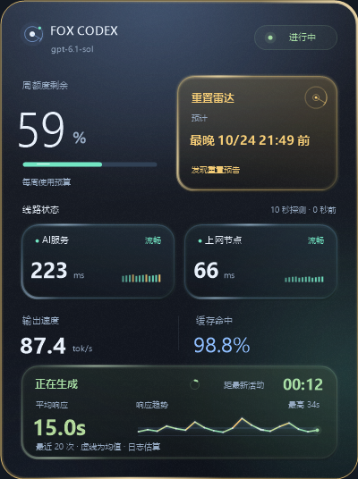
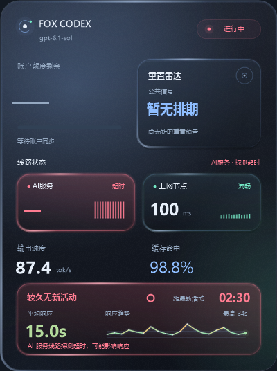

# FOX CODEX HUD

轻量、半透明、可点击穿透的 Windows Codex 桌面悬浮监控卡片。

基于 [drkang7/codex-token-hud](https://github.com/drkang7/codex-token-hud) 的 MIT 开源定制版。独立项目，与 OpenAI 无隶属关系。



## 功能

- **副屏右上角常驻**：置顶、78% 不透明度、鼠标穿透；托盘可选屏幕、透明度及临时解锁。
- **分级动态光效**：正常轻呼吸，高延迟渐变为黄、橙、红，超时扩散波纹；异常与恢复显示短提示。
- **主动网络探测**：每 10 秒检测 Clash Verge / Mihomo 中的 `AI节点`、`苏菲家宽`，保留最近 12 个真实测量点。探测超时 5 秒，不依赖代理软件自己刷新。
- **额度与重置雷达**：账户周额度、官方周重置倒计时，以及公共网站的额外重置预告。暂无排期仅表示没有公共预告，不影响周重置。
- **最近已重置**：没有新排期时，最近 10 小时内的公共完成记录显示绿色“已重置”与距今时间；储备次数发放单独标识。公告时间与实际完成时间明确区分，个人到账以左侧账户额度为准。
- **用途命名**：右侧显示“上网节点”，实际探测目标仍为代理软件中的“苏菲家宽”分组。
- **响应监控**：输出速度、缓存命中、模型、最新活动时间；最近最多 20 次有完整计时的模型响应取算术平均，排除工具执行和任务间空闲，依据本地日志估算。
- **渐进等待反馈**：生成等待达到 30/60/120 秒时加强提示；工具执行按 2/5/10 分钟分级。无新日志不等于已经确认网络故障。

## 下载与运行

从 [Releases](https://github.com/cupfox-coud/FOX-CODEX-HUD/releases) 下载 `FOX-CODEX-HUD-*-win-x64.zip`，解压到固定目录后运行 `CodexTokenHud.exe`。包含 Python 运行时，无需另外安装 Python。

需要 Windows 10/11 与 .NET Framework 4.x。登录后常驻可运行 `Install.ps1`，或通过托盘启用。关闭和退出通过托盘操作，临时解除穿透后 30 秒自动恢复。

为了兼容原有安装，内部可执行文件名和数据目录保留为 `CodexTokenHud.exe` 与 `%USERPROFILE%\.codex-token-hud`，界面与发布名称为 **FOX CODEX HUD**。不要同时运行原版和本版。

网络探测目前适配本机 Clash Verge Rev 配置与 Mihomo 控制器；目标分组必须对应 `AI节点`、`苏菲家宽`，不存在时明确显示不可用。控制器关闭时不会自行启用。账号额度需要本机已登录的 Codex 客户端。

## 动效与流畅度

使用原生 GDI+ 矢量渐变与有限层描边，不加载网页、粒子引擎或图片模糊库。动画最高 25 FPS，远程会话最高 10 FPS，采集频率保持独立；托盘展开时暂停额外动画帧，Windows 关闭动画时使用静态提示。延迟数字始终为实际测量值，不用动画插值制造虚假读数。



截图均使用测试数据，不包含真实会话、账户或节点地址。详细功能说明见 [中文说明](README.zh-CN.md)，数据处理见 [隐私说明](PRIVACY.md)。

## 开发

```powershell
.\Test.ps1 -PythonExecutable python.exe
.\Build.ps1 -OutputDirectory .\build\app
.\Package.ps1 -PythonExecutable python.exe
```

Windows UI 用 C#/.NET Framework 构建，采集器使用 Python 标准库。测试包含异常/恢复切换、减少动画模式、托盘交互、2000 次重绘资源检查，以及独立 Python 的便携包验证。当前增强动效仅针对 Windows 卡片；上游其他平台代码保留，见 [上游说明](docs/UPSTREAM_README.md)。

## 致谢与许可

感谢 [drkang7/codex-token-hud](https://github.com/drkang7/codex-token-hud)。保留上游版权、[MIT License](LICENSE) 与 [第三方声明](THIRD_PARTY_NOTICES.md)。
