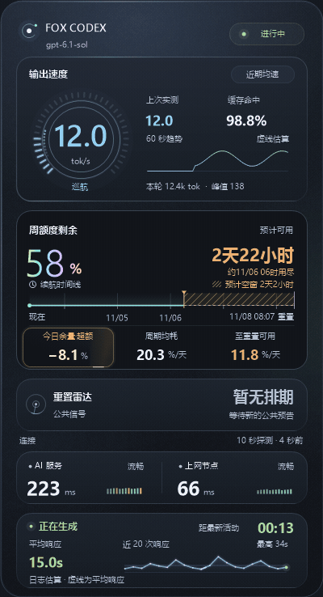
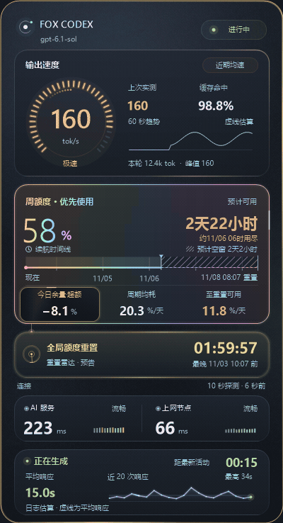

# FOX CODEX HUD

轻量、半透明、可点击穿透的 Windows Codex 桌面悬浮监控卡片。

基于 [drkang7/codex-token-hud](https://github.com/drkang7/codex-token-hud) 的 MIT 开源定制版。独立项目，与 OpenAI 无隶属关系。

**当前版本：corner.45 · Quiet Graphite** · [下载最新版](https://github.com/cupfox-coud/FOX-CODEX-HUD/releases) · [完整功能与动效图鉴](docs/SHOWCASE.md)

| 日常监控 | 全局额度重置 | 重置卡发放 |
| --- | --- | --- |
|  |  |  |
| 速度、额度、双线路与响应趋势 | 有效全局预告才提示优先使用 | 发卡保留倒计时，不催促清空额度 |

以上均为原生界面模拟数据截图。[查看动图、发放完成和内存保护状态 →](docs/SHOWCASE.md)

## 功能

- **输出速度仪表**：主数字显示最近最多 10 次已完成响应的加权均速，工具执行时保留实测值；右侧趋势区分实测与实时估算。缓存命中按输入 token 加权。主数字及 36 段仪表随绝对速度从蓝、青绿变为暖金与橙色；彗星、完成波纹和 60 秒趋势，满刻度可调。详见 [速度计算与接入](docs/SPEED.md)。
- **稳定跟随任务**：优先跟随最近发起的本地任务，其他较早任务和内部子代理持续写日志时不会反复抢占；也可按对话 ID 手动固定。
- **静谧石墨设计**：400×738 逻辑像素；统一表面、边距和字体层级。额度与续航并排，三列今日余量与每日预算、独立雷达横条、共用表面的双线路和底部响应趋势。常态保持克制，风险与新信号获得重点光效。设计参考及动效规格见 [设计说明](docs/DESIGN.md)。

- **副屏右上角常驻**：置顶、78% 不透明度、鼠标穿透；鼠标悬停时自动淡化到 25%，移开后恢复；托盘可选屏幕、透明度、悬停淡化及临时解锁。今日建议余量超支后显示负数，以墨黑内嵌表面、暖白数字及琥珀流光提醒；缓存、静态及低内存状态保留静态警告。周额度续航显示今日建议余量、本周期日均消耗及距重置前每天可用额度，按周期均速估算剩余可用时间；百分比大数字显示实际余额，开放时间轴以日期/小时刻度展示现在至官方周重置，薄荷细线表示可用时段，暖金斜纹标注“预计空窗 × 天”并缓慢移动；保留预计用尽日期和官方重置时间，缓存、静态和低内存时保留静止斜纹。下方三列标题及数值与单位整体居中。
- **分级动态光效**：正常轻呼吸，高延迟渐变为黄、橙、红，超时扩散波纹；异常与恢复显示短提示。
- **主动网络探测**：每 10 秒独立检测 Clash Verge / Mihomo 中的 `AI服务` 与 `苏菲家宽` 分组，分别显示为左侧 AI服务、右侧上网节点，保留最近 12 个真实测量点。探测超时 5 秒，不依赖代理软件自己刷新。
- **额度与重置雷达**：账户周额度、官方周重置倒计时，以及公共网站的额外重置预告。暂无排期仅表示没有公共预告，不影响周重置。
- **区分额度重置与发卡**：全局额度重置才联动周额度的优先使用和增强虹彩；重置卡发放使用独立紫色，明确“不自动重置额度”，不催促提前清空。混合事件显示“重置＋发卡”，类型不明时不做消耗建议。通知、倒计时和完成记录采用同一分类。
- **重置倒计时**：有预计截止或推测时点时，以倒计时为主并保留网站提供的日期；日期预告若包含时间窗口，则倒计时至窗口结束，标明具体重置时刻未定。预估到点后保留参考日期并等待网站更新。
- **虹彩额度与雷达联动**：平时周额度数字以柔和彩虹流动，速度随上方实测读数平滑加减速；出现有效全局重置预告后，整个额度表面、标题、数字、边缘和时间轴增强虹彩，保留向上扫光及优先使用提示；空窗斜纹与日期位置保持清晰。确认公共重置后短暂提示核对到账。数字不跳动，缓存、未知和实际耗尽有独立状态；静态及低内存时保留静态反馈。
- **雷达信号反馈**：全局重置预告持续暖金高亮并轻微呼吸，临近时转橙色，确认全局重置用绿色强调；发卡始终采用独立紫色。新预告、时间变更及重置确认触发 12 秒强化动效和系统通知，相同信号去重。
- **最近已重置**：没有新排期时，最近 10 小时内的公共完成记录显示绿色“已重置”与距今时间；储备次数发放单独标识。公告时间与实际完成时间明确区分，个人到账以左侧账户额度为准。
- **响应监控**：输出速度、缓存命中、模型、最新活动时间；最近最多 20 次有完整计时的模型响应取算术平均，排除工具执行和任务间空闲，依据本地日志估算。
- **渐进等待反馈**：生成等待达到 30/60/120 秒时加强提示；工具执行按 2/5/10 分钟分级。无新日志不等于已经确认网络故障。

## 下载与运行

从 [Releases](https://github.com/cupfox-coud/FOX-CODEX-HUD/releases) 下载 `FOX-CODEX-HUD-*-win-x64.zip`，解压到固定目录后运行 `CodexTokenHud.exe`。包含 Python 运行时，无需另外安装 Python。

需要 Windows 10/11 与 .NET Framework 4.x。登录后常驻可运行 `Install.ps1`，或通过托盘启用。关闭和退出通过托盘操作，临时解除穿透后 30 秒自动恢复。

建议将完整便携包固定安装到 `%LOCALAPPDATA%\Programs\FOX-CODEX-HUD`，在该目录运行 `Install.ps1`。桌面、开始菜单快捷方式和登录自启会绑定该目录；按 Windows 键搜索 `FOX CODEX HUD` 即可打开。后续覆盖更新仍使用同一入口。安装、更新与“采集暂停”的路径排查见 [固定安装说明](docs/INSTALLATION.md)。

为了兼容原有安装，内部可执行文件名和数据目录保留为 `CodexTokenHud.exe` 与 `%USERPROFILE%\.codex-token-hud`，界面与发布名称为 **FOX CODEX HUD**。不要同时运行原版和本版。

网络探测目前适配本机 Clash Verge Rev 配置与 Mihomo 控制器；目标分组为 `AI服务` 和 `苏菲家宽`（支持名称前的表情符号），不存在时明确显示不可用。控制器关闭时不会自行启用。账号额度需要本机已登录的 Codex 客户端。

## 动效与流畅度

如果面板看起来不动，右键托盘 → **面板动效 → 完整动效**。默认“跟随系统”会遵守 Windows 动画开关，关闭该系统开关时使用静态展示。此选项只影响面板，不修改 Windows 设置。

使用原生 GDI+ 矢量渐变、缓存的环境底色与有限层描边，不加载网页、粒子引擎或图片模糊库。动画定时器 25 Hz，远程会话 10 Hz，采集频率保持独立；托盘展开时暂停额外动画帧，默认跟随 Windows 动画设置；托盘“面板动效”可选完整动效、跟随系统或静态显示，选择会保存。延迟数字始终为实际测量值，不用动画插值制造虚假读数。

当 Windows 系统可提交内存或可用物理内存过低时，卡片自动进入“轻量绘制”：暂停动效、释放背景位图并降低刷新频率，保留数据和雷达。系统内存恢复并稳定 30 秒后，会自动恢复原来的动效偏好。即使绘图分配失败，也会先尝试轻量界面；意外退出时，受管启动器会限速重启，手动退出仍保持退出。

卡片会检查实际窗口顺序：如果其他窗口盖住它，会在不抢输入焦点或改变位置的情况下恢复置顶；托盘菜单和正在操作的临时弹窗会优先显示。

| 速度变色与额度虹彩加速 | 全局重置雷达与额度联动 |
| --- | --- |
|  |  |

[查看全部截图、动效说明与功能表](docs/SHOWCASE.md)

截图均使用测试数据，不包含真实会话、账户或节点地址。详细功能说明见 [中文说明](README.zh-CN.md)，数据处理见 [隐私说明](PRIVACY.md)。

## 开发

```powershell
.\Test.ps1 -PythonExecutable python.exe
.\Build.ps1 -OutputDirectory .\build\app
.\Package.ps1 -PythonExecutable python.exe
```

Windows UI 用 C#/.NET Framework 构建，采集器使用 Python 标准库。测试包含异常/恢复切换、减少动画模式、托盘交互、2000 次重绘资源检查，以及独立 Python 的便携包验证。当前增强动效仅针对 Windows 卡片；上游其他平台代码保留，见 [上游说明](docs/UPSTREAM_README.md)。

## 致谢与许可

速度计算与仪表动效参考 [zoefix/agent-speed](https://github.com/zoefix/agent-speed)，保留 MIT 声明。感谢 [drkang7/codex-token-hud](https://github.com/drkang7/codex-token-hud)。保留上游版权、[MIT License](LICENSE) 与 [第三方声明](THIRD_PARTY_NOTICES.md)。
