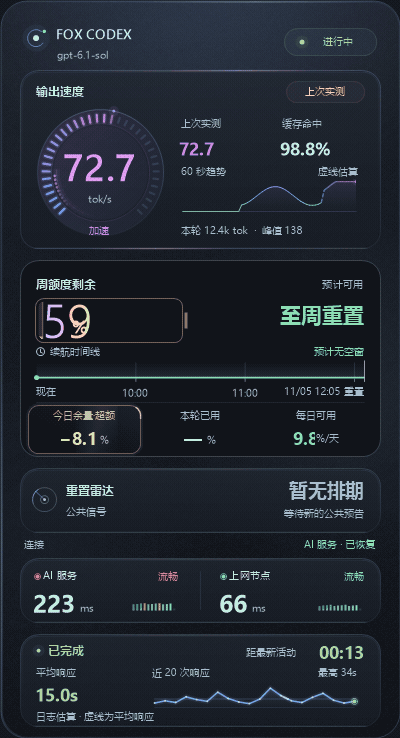
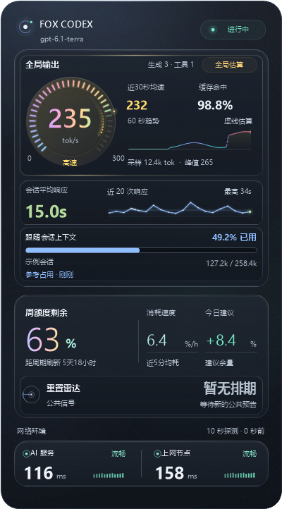
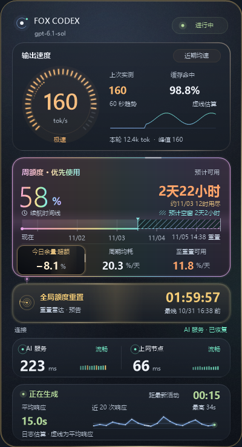
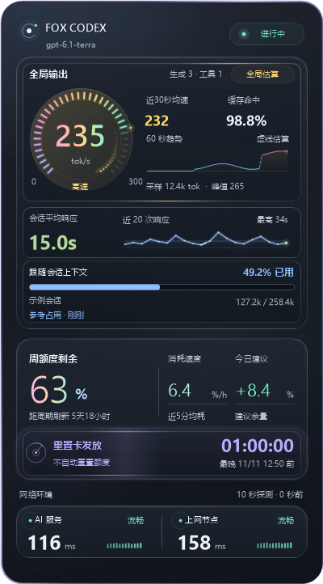

# FOX CODEX HUD

一张轻量的 Windows 桌面悬浮面板，把 Codex 的全局输出、当前会话上下文、账户周额度、重置雷达和两条网络线路放在一起。

**当前源码版本：1.3.0-beta.8.corner.55** · [现有发行版](https://github.com/cupfox-coud/FOX-CODEX-HUD/releases) · [功能图鉴](docs/SHOWCASE.md) · [中文使用说明](README.zh-CN.md)

<p align="center"></p>

<p align="center">原生界面演示 · 模拟数据，不包含真实会话或账户信息</p>

## 一眼看懂当前状态

| 日常监测 | 全局额度重置 | 重置卡发放 |
| --- | --- | --- |
|  |  |  |
| 输出、响应、上下文与额度分组展示。 | 确认属于全局额度重置时，才提示优先使用。 | 紫色发卡提示保留倒计时，不催促提前用完额度。 |

截图由当前原生绘制器和人工构造的样本生成。更多状态与动效说明见 [功能图鉴](docs/SHOWCASE.md)。

## 功能

- **全局输出速度**：聚合本机可见 Codex 任务的输出，显示当前速度、30 秒均速、缓存命中与 60 秒趋势。仪表默认满刻度 300 tok/s，超过 200 tok/s 呈现流动光谱；加速反馈限制在输出区域。数据不完整或估算会明确标注。[计算方法](docs/SPEED.md)
- **当前会话上下文**：跟随最近查看的 Codex 桌面聊天，切到其他应用后保留该会话。显示最近一次请求上报的输入量 / 模型上下文窗口；达到 70% 建议准备交接，85% 建议保存交接并开启新对话。阈值是产品提醒，不是模型质量的精确分界。[上下文说明](docs/CONTEXT.md)
- **周额度与今日建议**：显示官方周额度剩余、近期实际消耗速度（%/小时）及今日建议余量；超过建议后显示负数。速度根据最近最多 5 分钟的实际额度下降计算，不把 token 数换算成额度；样本不足会显示采样中。[计算说明](docs/QUOTA_RUNWAY.md)
- **重置雷达**：公共信号区分全局额度重置、重置卡发放及混合事件，展示倒计时、来源日期和通知。公共公告不证明个人额度到账；账户实际状态以官方额度接口为准。
- **双线路监测**：分别检测 Clash Verge / Mihomo 的 `AI服务` 与 `苏菲家宽` 分组，展示实际延迟和最近采样，不切换节点。
- **桌面体验**：置顶、鼠标穿透、悬停淡化与屏幕位置记忆；支持系统动画偏好。内存紧张时自动降低绘制开销，恢复稳定后回到原有动效。

## 下载与安装

从 [GitHub Releases](https://github.com/cupfox-coud/FOX-CODEX-HUD/releases) 查看可用的预构建包和 SHA-256 校验文件，发行版版本可能落后于本页源码。需要 Windows 10/11 与 .NET Framework 4.x；预构建包自带 Python。若发行版尚无 corner.55，可用仓库源码和下方的 `Package.ps1` 构建；构建环境需要 Python。

将完整包解压到固定目录（推荐 `%LOCALAPPDATA%\Programs\FOX-CODEX-HUD`），运行 `Install.ps1`。桌面快捷方式、开始菜单和登录启动指向同一个安装目录；详细步骤与排障见 [Windows 安装说明](docs/INSTALLATION.md)。右键托盘可调整动效、屏幕、透明度及会话绑定。

## 数据与限制

雷达使用 [Did Codex Reset 公共 API](https://didcodexreset.com/zh/api.html)。状态每 3 分钟检查一次；信号不变时复用已验证的来源时间，约 12–15 分钟复核一次，常态约 25 次请求 / 小时。信号变化时会额外复核。该站对同一出口 IP 的所有客户端共享每小时 60 次限制；受限时遵守服务端的重试时间，不能保证共享出口一定有剩余额度。

账户额度来自已登录 Codex 客户端；上下文和速度来自本地日志。公共雷达不接收账户、凭据或对话内容；双线路探测会访问公开的连接测试地址。具体数据处理、限制和本机保存内容见 [隐私说明](PRIVACY.md)。

## 开发与验证

```powershell
.\Test.ps1 -PythonExecutable python.exe
.\TestContextLayout.ps1
.\TestContextLayout.ps1 -Showcase  # 生成模拟数据的原生截图和动画帧
.\Package.ps1 -PythonExecutable python.exe
```

Windows 卡片采用 C#/.NET Framework 原生绘制，采集器使用 Python 标准库。macOS/Linux 原有组件与兼容范围见 [中文说明](README.zh-CN.md) 和 [兼容说明](docs/COMPATIBILITY.md)。

## 致谢

基于 [drkang7/codex-token-hud](https://github.com/drkang7/codex-token-hud) 的 MIT 开源项目；输出速度参考 [zoefix/agent-speed](https://github.com/zoefix/agent-speed)，上下文占用参考 [aris477/codex-context-monitor](https://github.com/aris477/codex-context-monitor)。本项目与 OpenAI 无隶属关系。详见 [MIT License](LICENSE) 和 [第三方声明](THIRD_PARTY_NOTICES.md)。
