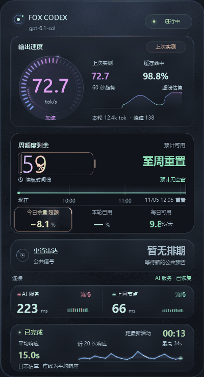

# FOX CODEX HUD · corner.48

生成时主数字显示当前三秒速率。明显提速会触发追光和增量读数，稳速后光效收敛。速度色调从青蓝经过紫色、玫瑰色，最终过渡到金色。周额度采用电池显示，填充宽度等于实际剩余百分比，日期轴上的斜纹代表预计用尽后等待刷新的时段。

- 本轮已用显示实际扣减，日均消耗速率仅用于预测续航。今日建议预算随本地午夜、真实刷新或确认补额重新计算。
- 新日志及时更新额度，账户接口核实同周期补额。迟到的旧余额和轻微修正不会清空累计消耗。
- 延迟、倒计时和响应数字平滑切换。公共雷达分别标明全局重置和发卡，静态及低内存模式保留清晰的读数。

[查看功能截图](https://github.com/cupfox-coud/FOX-CODEX-HUD/blob/v1.3.0-beta.8.corner.48/docs/SHOWCASE.md)

Windows x64 用户下载 **FOX-CODEX-HUD-1.3.0-beta.8.corner.48-win-x64.zip**，解压到固定目录后运行 CodexTokenHud.exe。压缩包自带 Python，SHA-256 校验文件随包提供。
