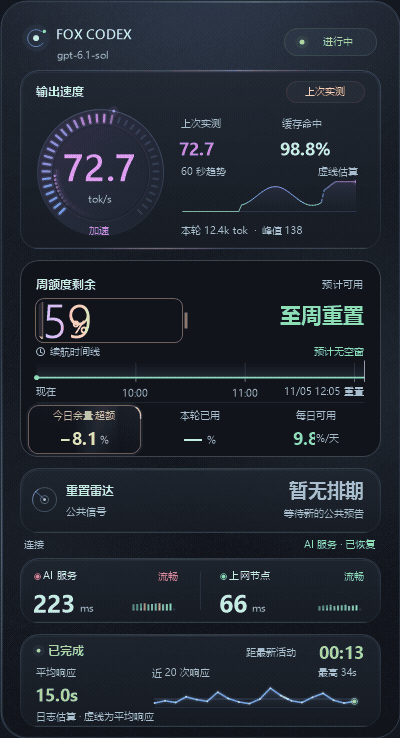
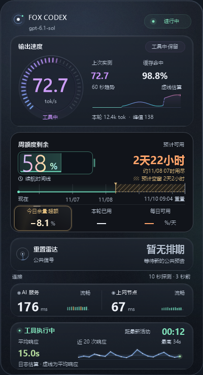
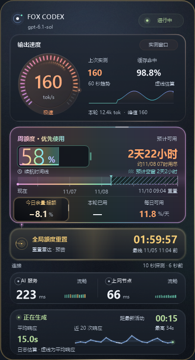
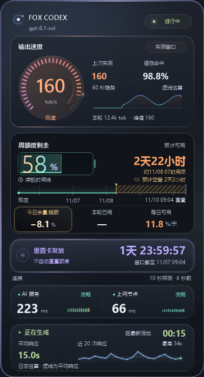
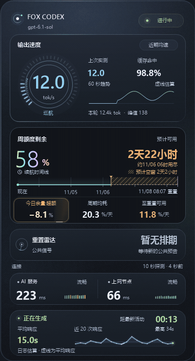
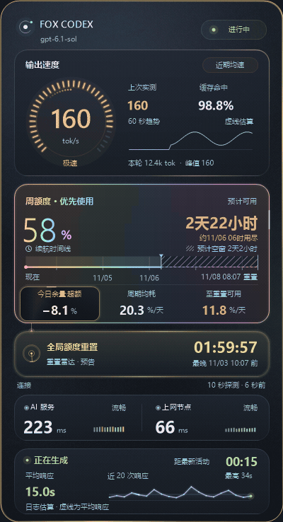
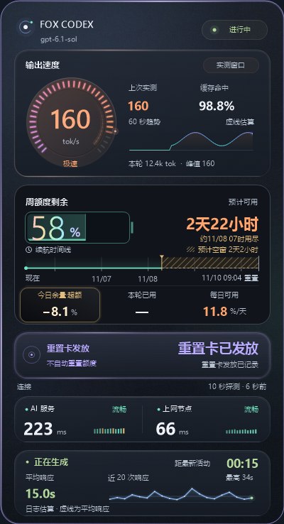
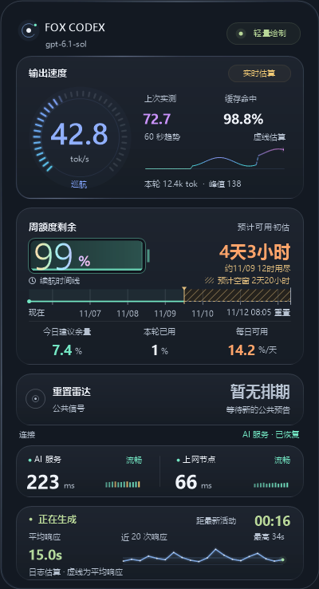

# FOX CODEX HUD · 功能与动效图鉴

当前 Windows 版本为 **1.3.0-beta.8.corner.48**。所有图片和动图均由原生界面使用模拟数据渲染。日期、额度与速率仅用于展示。

动图展示两次明显提速。增量数字出现时，追光环绕仪表，卡面亮起当前速度的颜色。额度刷新将电池充满，之后按实际扣减向左回落。

## 三种日常状态

| 日常监控 | 全局额度重置预告 | 重置卡发放预告 |
| --- | --- | --- |
|  |  |  |
| 柔和彩虹额度，清晰的日期时间轴与每日用量建议。 | 明确属于全局重置时，提示优先使用，额度表面和时间轴联动增强虹彩。 | 紫色“重置卡发放”与“不自动重置额度”，保留 API 倒计时，不催促提前清空。 |

`global_and_banked` 会明确显示“重置＋发卡”；缺失或未知类型不触发清空建议。发卡完成与额度重置完成也分别提示，个人额度以账户实际同步为准。

## 输出速度与虹彩联动

演示依次展示 **12 → 48 → 160 tok/s**：速度主数字与已亮刻度从青蓝过渡到蓝紫、玫瑰与暖金，下方额度的虹彩同步平滑加速。数字保持真实读数，动画不会插值制造读数。

主数字优先采用最近已完成响应的加权均速，在工具执行时保留实测值；实测与有效估算有明确标注。趋势实线代表实测，虚线代表估算。计算范围、来源与限制见 [速度说明](SPEED.md)。

## 全局重置到来时的联动

发现有效全局重置预告后，上行光点、额度表面、边缘、百分比及时间轴同步反馈。相同信号去重，新预告或有意义的变更获得短暂加强；发卡事件采用独立紫色局部反馈。

## 额度与续航怎么读

- **周额度大数字**：账户返回的实际剩余百分比。
- **预计可用时间与日期**：按本周期额度使用情况估算，并与个人官方周重置时间比较。
- **时间轴**：从现在到官方重置；薄荷细线表示预计可用时段，暖金斜纹明确标出预计用尽后的空窗。
- **今日建议余量**：当天建议预算减去已观察到的真实消耗；超支后继续显示负数，用墨黑、暖白与琥珀反光提醒。
- **周期均耗 / 至重置可用**：分别表示已发生的日均消耗与今后平均每天可用的额度。

预测保持稳定，缺少样本、缓存或数据过期时有对应状态。计算详见 [额度续航说明](QUOTA_RUNWAY.md)。

## 发放完成与内存保护

| 重置卡已发放 | 内存紧张时的轻量绘制 |
| --- | --- |
|  |  |
| 提示查看重置卡到账，不显示额度恢复动效。 | 暂停装饰动画、释放背景缓存，继续展示数据；内存恢复稳定后恢复原动效偏好。 |

## 功能一览

| 功能 | 行为 |
| --- | --- |
| 速度仪表 | 36 段刻度、速度颜色、彗星和完成波纹，可调整满刻度 |
| 周额度与续航 | 实际余额、稳定预测、日期时间轴、斜纹空窗和负数每日建议余量 |
| 公共重置雷达 | 全局重置 / 发卡分类，倒计时与 API 日期并列，变更识别和系统通知 |
| 双线路监测 | 独立检测 AI 服务与上网节点，每 10 秒采样，保留真实延迟历史 |
| 响应监测 | 当前活动与等待时长，最近最多 20 次响应均值及趋势，渐进等待反馈 |
| 置顶与穿透 | 检查实际窗口顺序，在不抢焦点的情况下恢复置顶；支持临时解锁 |
| 悬停淡化 | 穿透开启时悬停自动淡化，移开恢复保存的透明度 |
| 屏幕与缩放 | 托盘选择屏幕，按工作区自适应，保留位置和显示偏好 |
| 动效偏好 | 完整动效、跟随系统、静态显示；远程会话降低动画频率 |
| 内存保护 | 内存紧张时降低绘制开销，恢复稳定后再恢复动效 |
| 固定安装入口 | 桌面、开始菜单和登录自启使用同一安装目录 |
| 本地数据 | 基于本机日志与客户端账户状态，不上传会话内容；详见 [隐私说明](../PRIVACY.md) |

[返回首页](../README.md) · [固定安装](INSTALLATION.md) · [完整中文说明](../README.zh-CN.md)
